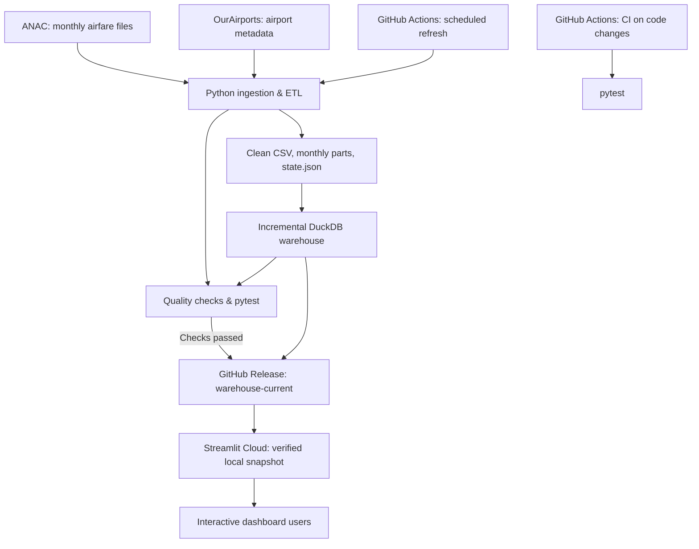
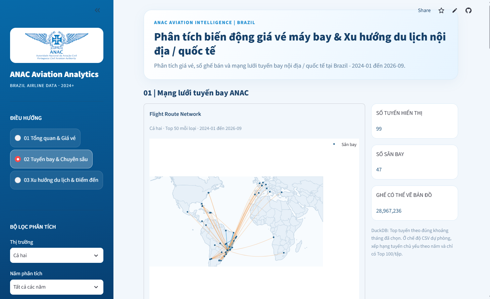

# ANAC Brazil Airfare Analytics

**End-to-End Data Engineering & Analytics Portfolio**  
*Phân tích biến động giá vé máy bay và xu hướng di chuyển nội địa, quốc tế tại Brazil*

Dự án xây dựng một quy trình dữ liệu từ thu thập dữ liệu hàng không công khai đến xử lý, kiểm tra chất lượng, cập nhật Data Warehouse và trực quan hóa trên web. Trọng tâm kỹ thuật là **incremental ETL**, **DuckDB**, **kiểm thử tự động** và **triển khai Dashboard độc lập với máy cá nhân**.

**[Xem Dashboard trực tuyến](https://anac-brazil-analytics.streamlit.app/)** · **[Mã nguồn](https://github.com/luong-nt/phan-tich-gia-ve-may-bay-va-xu-huong-du-lich-noi-dia-quoc-te-anac)** · **[DuckDB snapshot hiện hành](https://github.com/luong-nt/phan-tich-gia-ve-may-bay-va-xu-huong-du-lich-noi-dia-quoc-te-anac/releases/tag/warehouse-current)**

> **Phạm vi diễn giải:** Dữ liệu phản ánh hoạt động bán vé hàng không, không đo trực tiếp số khách du lịch hay mục đích di chuyển. Tháng dữ liệu là **tháng bán vé**, không nhất thiết là tháng thực hiện chuyến bay.

## 1. Bài toán và mục tiêu

Dữ liệu giá vé được ANAC công bố theo từng kỳ, có thể khác nhau về cấu trúc, cách biểu diễn số và mức độ đầy đủ. Nếu tải và xử lý thủ công, việc cập nhật số liệu và đối chiếu kết quả giữa các kỳ trở nên khó duy trì.

Dự án giải quyết bốn yêu cầu:

1. **Tự động thu thập và chuẩn hóa** các file dữ liệu định kỳ từ nguồn công khai.
2. **Lưu trữ dữ liệu phân tích có cấu trúc** để truy vấn theo tháng, thị trường, tuyến bay và sân bay.
3. **Kiểm tra chất lượng và cập nhật tăng dần**, tránh phải nạp lại toàn bộ dữ liệu khi chỉ một số kỳ thay đổi.
4. **Cung cấp Dashboard trực tuyến**, có thể truy cập qua liên kết mà không cần tải repository hay khởi động máy cá nhân của tác giả.

Các câu hỏi phân tích chính: giá vé và số ghế bán thay đổi thế nào theo kỳ; tuyến bay/điểm đến nào nổi bật; phân phối giá và so sánh cùng kỳ giữa các năm ra sao; mức liên hệ giữa giá vé và số ghế bán như thế nào.

## 2. Điểm nổi bật của dự án

| Thành phần | Giải pháp triển khai |
|---|---|
| Data ingestion | Python `requests` phát hiện và tải file ANAC theo kỳ từ website công khai; không sử dụng API REST chính thức của ANAC |
| Transformation | Pandas/NumPy làm sạch kiểu dữ liệu, chuẩn hóa đơn vị và tổng hợp các chỉ số |
| Incremental processing | Theo dõi `state.json`, các `parts` theo tháng và cập nhật các kỳ mới hoặc thay đổi |
| Data warehouse | DuckDB với Fact/Dimension và các SQL view phục vụ phân tích |
| Data quality | Quality Gate, đối chiếu dữ liệu và bộ kiểm thử `pytest` |
| Automation | GitHub Actions kiểm thử khi thay đổi code và chạy pipeline cập nhật theo lịch |
| Data delivery | Xuất bản `anac.duckdb` đã kiểm tra lên GitHub Releases |
| Presentation | Streamlit + Plotly; Dashboard được triển khai bằng Streamlit Community Cloud |

### Vai trò và phạm vi triển khai

Đây là dự án portfolio cá nhân, tập trung vào cả **xử lý dữ liệu** và **phân tích trực quan**. Phạm vi triển khai bao gồm thu thập dữ liệu công khai, thiết kế bước làm sạch và tổng hợp, xây dựng mô hình phân tích DuckDB, kiểm thử dữ liệu, cấu hình workflow GitHub Actions và triển khai Dashboard Streamlit. Các kết quả kiểm chứng được dẫn tới mã nguồn, workflow và Release để người đọc có thể đối chiếu.

## 3. Kiến trúc hệ thống



### Các quyết định kỹ thuật

- **DuckDB thay vì chỉ dùng CSV:** hỗ trợ truy vấn SQL trên mô hình Fact/Dimension, tổng hợp theo nhiều chiều và phân tích tuyến bay mà không phải tải toàn bộ dữ liệu lên giao diện.
- **Incremental update:** nhận diện dữ liệu theo kỳ, đối chiếu trạng thái trước khi thêm hoặc thay thế; hạn chế xử lý lại không cần thiết.
- **GitHub Releases thay vì commit database vào Git:** file DuckDB được phân phối như một snapshot riêng; repository lưu mã nguồn và các dữ liệu nhỏ được chọn.
- **Kiểm tra trước khi phát hành:** workflow chỉ xuất bản sau các bước kiểm tra ETL, kiểm thử và xác thực dữ liệu trong warehouse.
- **Cloud snapshot validation:** ứng dụng kiểm tra thông tin asset, dung lượng, SHA-256 (khi metadata cung cấp) và các đối tượng DuckDB cốt lõi trước khi sử dụng phiên bản tải về.

## 4. Nguồn dữ liệu và phạm vi

| Nguồn | Mục đích |
|---|---|
| [ANAC Open Data](https://www.gov.br/anac/pt-br/acesso-a-informacao/dados-abertos) | Dữ liệu giá vé và số ghế bán của thị trường nội địa/quốc tế Brazil |
| [OurAirports](https://ourairports.com/data/) | Tham chiếu mã, tên, vị trí và tọa độ sân bay |

**Phạm vi dữ liệu:** các kỳ khả dụng từ **2024 đến 2026**, được hiển thị theo đúng kỳ hiện có; **2026 là năm chưa đầy đủ**. Các thị trường cũng không nhất thiết có cùng số kỳ. Khi so sánh năm, Dashboard chỉ sử dụng những tháng có thể đối chiếu hợp lệ.

**Đơn vị:** giá vé nội địa sử dụng **BRL**, quốc tế sử dụng **USD**. Không cộng gộp hoặc so sánh trực tiếp giá trị tiền tệ giữa hai thị trường khi chưa chuẩn hóa tỷ giá.

**Giới hạn:** số ghế bán không đồng nghĩa số hành khách thực tế; dữ liệu vé không xác định mục đích chuyến đi; các sân bay thiếu tọa độ sẽ không được thể hiện đầy đủ trên bản đồ.

## 5. Mô hình dữ liệu và phương pháp tính

Warehouse sử dụng các bảng dimension về **tháng**, **thị trường** và **sân bay**, cùng bảng fact `fact_airfare_route_monthly` ở cấp độ **tuyến đi – tuyến đến – tháng bán – thị trường**. View `vw_monthly_kpi` phục vụ chỉ số tổng hợp theo tháng.

Giá vé bình quân có trọng số được tính theo số ghế:

$$
\overline{P} = \frac{\sum_i P_i S_i}{\sum_i S_i}
$$

Trong đó `Pᵢ` là giá vé của bản ghi và `Sᵢ` là số ghế bán tương ứng. Các phân vị **P10, P25, Median, P75, P90** được tính từ dữ liệu giá ở cấp độ phù hợp với trọng số số ghế, **không suy ngược từ giá bình quân đã tổng hợp**.

Biến động theo tháng chỉ được tính khi có **hai tháng liền kề thực sự**; so sánh YoY dùng tập tháng tương ứng giữa hai năm. Tương quan thống kê được sử dụng để mô tả sự liên hệ, **không kết luận quan hệ nhân quả**.

## 6. Dashboard trực tuyến

**Live demo:** https://anac-brazil-analytics.streamlit.app/

Dashboard có ba nhóm chức năng:

1. **Tổng quan và giá vé:** KPI thị trường, giá vé bình quân, số ghế bán, biến động theo tháng, so sánh năm và phân phối giá.
2. **Tuyến bay và phân tích chuyên sâu:** bản đồ mạng lưới bay, xếp hạng tuyến, Pareto, Dumbbell và các phân tích theo bộ lọc.
3. **Xu hướng du lịch và điểm đến:** xếp hạng điểm đến, phân bố số ghế và diễn biến theo thời gian. Đây là **chỉ báo dựa trên bán vé**, không phải ước lượng trực tiếp khách du lịch.

Các bộ lọc chính gồm **thị trường**, **năm**, **khoảng tháng** và số lượng tuyến hoặc điểm đến hiển thị. Dashboard hiển thị nguồn dữ liệu đang sử dụng để dễ phân biệt DuckDB với CSV dự phòng.

### Giao diện Dashboard thực tế

Ảnh dưới đây được chụp từ ứng dụng Streamlit Community Cloud, thể hiện bản đồ tuyến bay, các chỉ số tổng hợp và bộ lọc tương tác.



*Hình 2. Mạng lưới tuyến bay và một số chỉ số phân tích của hệ thống.*

Ba nhóm phân tích có thể được truy cập trực tiếp tại [Dashboard ANAC Brazil](https://anac-brazil-analytics.streamlit.app/).

## 7. Tự động hóa và cập nhật dữ liệu

### CI – kiểm thử khi thay đổi mã nguồn

File: [`.github/workflows/ci-tests.yml`](.github/workflows/ci-tests.yml)

- Kích hoạt khi có `push` hoặc Pull Request liên quan tới mã Python, dependencies hoặc CI workflow.
- Cài dependencies trong môi trường Python **3.11** trên GitHub Actions.
- Chạy `python -m pytest tests/ -q`; không sửa hay xuất bản dữ liệu.

### ETL – cập nhật theo lịch

File: [`.github/workflows/cap-nhat-du-lieu.yml`](.github/workflows/cap-nhat-du-lieu.yml)

- Lịch cấu hình: **05:23 UTC hằng ngày** (tương ứng **12:23 giờ Việt Nam**); thời điểm thực thi thực tế có thể trễ hoặc không chạy theo bảo đảm thời gian thực.
- Hỗ trợ chạy thủ công với hai chế độ: `check` (kiểm tra) và `update` (cập nhật).
- Chuỗi xử lý: kiểm tra dữ liệu → ETL theo kỳ → cập nhật phân phối giá → xác thực → pytest → tải DuckDB hiện hành → cập nhật tăng dần → kiểm tra warehouse → commit dữ liệu nhỏ đã thay đổi → xuất bản DuckDB nếu có thay đổi.
- Bản snapshot được xuất bản dưới tag [`warehouse-current`](https://github.com/luong-nt/phan-tich-gia-ve-may-bay-va-xu-huong-du-lich-noi-dia-quoc-te-anac/releases/tag/warehouse-current). Bản [`warehouse-bootstrap-v1`](https://github.com/luong-nt/phan-tich-gia-ve-may-bay-va-xu-huong-du-lich-noi-dia-quoc-te-anac/releases/tag/warehouse-bootstrap-v1) được giữ để khởi tạo/dự phòng.

### Đồng bộ với Streamlit

File: [`anac_cloud_warehouse.py`](anac_cloud_warehouse.py)

Khi không có DuckDB cục bộ, Dashboard tải snapshot công khai từ Release. Metadata được cache **5 phút**; khi ứng dụng đang hoạt động, có cơ chế kiểm tra định kỳ khoảng **10 phút**. Khi nhận diện phiên bản asset mới, ứng dụng tải bản mới và chạy lại các truy vấn cần thiết. **Đây là cập nhật định kỳ, không phải streaming hoặc thời gian thực.**

Nếu truy cập Release tạm thời thất bại nhưng bản snapshot đã xác thực trước đó còn tồn tại, ứng dụng có thể tiếp tục dùng bản cache đó.

## 8. Kiểm thử và bằng chứng triển khai

Các mốc kiểm chứng ghi nhận trong quá trình phát triển (không phải số liệu được đo lại ở mỗi lần mở README):

| Mốc | Kết quả ghi nhận |
|---|---|
| Unit tests cục bộ, 04/11/2026 | **37 passed, 1 warning** (`anyio`/pytest deprecation) |
| Data Quality Gate ở lần báo cáo trước | **399 PASS, 0 FAIL, 2 WARN** |
| Kiểm tra đồng bộ cục bộ | **32/32 parts không thay đổi** tại thời điểm kiểm tra |
| CI trên GitHub Actions | Workflow đã chạy thành công sau khi khắc phục lỗi import |
| Cloud Warehouse Check | Workflow tải và xác minh snapshot thành công |
| ETL + Release publishing | Lần chạy thủ công `update` đã hoàn tất và tạo `warehouse-current` |
| Streamlit Community Cloud | Dashboard đã triển khai với URL công khai |

**Bằng chứng có thể kiểm tra:** [GitHub Actions](https://github.com/luong-nt/phan-tich-gia-ve-may-bay-va-xu-huong-du-lich-noi-dia-quoc-te-anac/actions) · [Release hiện hành](https://github.com/luong-nt/phan-tich-gia-ve-may-bay-va-xu-huong-du-lich-noi-dia-quoc-te-anac/releases/tag/warehouse-current) · [Mã kiểm thử](tests/)

Hai cảnh báo Quality Gate được ghi nhận trước đó liên quan đến **kỳ dữ liệu nội địa 05/2026 chưa có** và **một số dòng Fact chưa đủ tọa độ sân bay**. Đây là giới hạn dữ liệu cần công bố rõ, không tự thay kỳ thiếu bằng giá trị 0. Kết quả kiểm thử chỉ xác nhận những quy tắc đã triển khai, không chứng minh mọi bản ghi nguồn hoàn toàn chính xác.

## 9. Cấu trúc repository

```text
project/
├── .github/workflows/
│   ├── ci-tests.yml                    # CI khi thay đổi code
│   ├── check-cloud-warehouse.yml       # Kiểm tra snapshot trên runner
│   └── cap-nhat-du-lieu.yml            # Scheduled ETL & Release publish
├── DuLieu_DaXuLy/                     # Dữ liệu tổng hợp và ETL state/parts
├── data_warehouse/
│   ├── schema.sql
│   ├── load_warehouse.py
│   ├── incremental_warehouse.py
│   └── ...                             # Phân phối giá, queries, kết quả phân tích
├── tests/                              # Unit tests
├── scripts/                            # Kiểm tra và tác vụ hỗ trợ
├── docs/                               # Tài liệu và ảnh minh chứng
├── assets/                             # Tài nguyên giao diện
├── cap_nhat_anac.py                    # ANAC ingestion/ETL
├── qa_quality_gate.py                 # Data-quality checks
├── anac_cloud_warehouse.py            # Tải & xác minh DuckDB Release
├── dashboard_v4_analytics.py          # Hàm phân tích dùng bởi Dashboard
├── dashboard.py                       # Entry point Streamlit
├── requirements.txt
└── README.md
```

Sơ đồ chỉ thể hiện các thành phần chính. Các file được giữ lại vì tương thích hoặc phục vụ phát triển có thể không được liệt kê. Snapshot `.duckdb` và dữ liệu nguồn thô không được commit vào Git.

## 10. Chạy dự án trên máy cá nhân

**Khuyến nghị:** Python 3.11 (cùng phiên bản với CI), Git và kết nối Internet để tải DuckDB Release nếu máy chưa có database cục bộ.

```bash
git clone https://github.com/luong-nt/phan-tich-gia-ve-may-bay-va-xu-huong-du-lich-noi-dia-quoc-te-anac.git
cd phan-tich-gia-ve-may-bay-va-xu-huong-du-lich-noi-dia-quoc-te-anac
python -m pip install -r requirements.txt
python -m streamlit run dashboard.py
```

Mở `http://localhost:8501`. Khi không tìm thấy `data_warehouse/anac.duckdb`, Dashboard sẽ thử tải snapshot từ GitHub Releases. Muốn **buộc dùng bản Cloud** ngay cả khi có database cục bộ, chạy trên PowerShell:

```powershell
$env:ANAC_WAREHOUSE_SOURCE = "release"
python -m streamlit run dashboard.py
```

Kiểm thử và kiểm tra đồng bộ:

```bash
python -m pytest tests/ -q
python data_warehouse/incremental_warehouse.py --check
python cap_nhat_anac.py --check
```

Các lệnh `--check` không nhằm cập nhật DuckDB. Việc **tái lập toàn bộ ETL từ dữ liệu thô** có thể yêu cầu thêm file nguồn/dữ liệu nền không được phân phối trong repository. Để xem Dashboard, nên dùng Release snapshot sẵn có.

## 11. Hạn chế và hướng phát triển

- Không phải tất cả các kỳ năm 2026 hoặc cả hai thị trường đều có đầy đủ dữ liệu; không tự suy diễn các tháng thiếu.
- Chất lượng phân tích bản đồ phụ thuộc dữ liệu tọa độ sân bay; một số tuyến không có đủ tọa độ.
- Nguồn công khai có thể thay đổi cấu trúc hoặc gián đoạn truy cập; pipeline cần tiếp tục được theo dõi trên GitHub Actions.
- Lịch chạy GitHub Actions và việc làm mới Streamlit không bảo đảm cập nhật tức thời.
- Quy trình thay asset trên GitHub Releases chưa phải cơ chế phát hành/rollback nguyên tử cấp production.

**Hướng cải thiện tiếp theo:** tăng độ bao phủ kiểm thử tích hợp và kiểm thử dữ liệu, theo dõi trạng thái cập nhật/độ trễ, bổ sung ảnh hai trang phân tích còn lại, hoàn thiện tài liệu tái lập ETL và tối ưu truy vấn phân tích khi dữ liệu tăng.

## 12. Tài liệu tham khảo

- [ANAC – Open Data](https://www.gov.br/anac/pt-br/acesso-a-informacao/dados-abertos)
- [OurAirports – Data](https://ourairports.com/data/)
- [DuckDB Documentation](https://duckdb.org/docs/)
- [Pandas Documentation](https://pandas.pydata.org/docs/)
- [GitHub Actions Documentation](https://docs.github.com/en/actions)
- [Streamlit Documentation](https://docs.streamlit.io/)
- [Plotly Python Documentation](https://plotly.com/python/)

---

*Personal portfolio / academic project using publicly available data. Results are exploratory and do not represent official ANAC forecasts or certified tourism statistics.*
