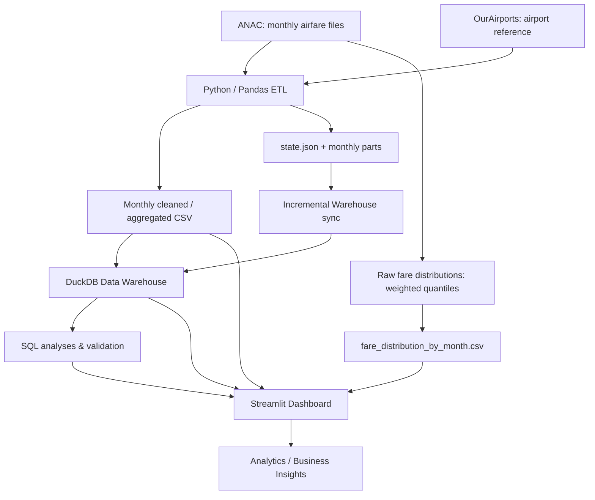

# Phân tích giá vé máy bay và xu hướng du lịch nội địa quốc tế ANAC

**Brazil Airfare Analytics | End-to-End Data Analytics & Data Engineering Portfolio Project**

Dự án phân tích **giá vé, số ghế bán, mạng lưới tuyến bay và xu hướng mua vé hàng không tại Brazil** từ dữ liệu công khai của **ANAC (Agência Nacional de Aviação Civil)**. Quy trình gồm thu thập và làm sạch dữ liệu, ETL tăng dần, lưu trữ phân tích trên **DuckDB**, kiểm thử chất lượng và trực quan hóa bằng **Streamlit/Plotly**.

> **Phạm vi:** Đây là phân tích thị trường **vé máy bay**, không phải phép đo trực tiếp lượng khách du lịch. Tháng tham chiếu của dữ liệu là **tháng bán vé**, không nhất thiết là tháng chuyến bay diễn ra.

## 1. Tổng quan

| Nội dung | Thông tin |
|---|---|
| Thời gian | 2024–2026 (theo những kỳ nguồn đã có) |
| Thị trường | Nội địa Brazil và quốc tế |
| Công nghệ | Python, Pandas, NumPy, SQL, DuckDB, Streamlit, Plotly, Requests |
| Kho dữ liệu | DuckDB, mô hình Fact/Dimension cho phân tích tuyến–tháng |
| Xử lý tự động | ETL từ ANAC, trạng thái theo tháng, cập nhật DuckDB tăng dần |
| Đầu ra | Dashboard 3 trang, thống kê giá vé, số ghế, tuyến và điểm đến |
| Chất lượng | **399 PASS / 0 FAIL / 2 WARN** ở Data Quality Gate; **33 pytest PASS / 1 warning** tại lần kiểm thử gần nhất |

**Demo Dashboard:** bổ sung liên kết sau khi kiểm tra phiên bản đang triển khai khớp với mã nguồn trong repository.

### Hình ảnh Dashboard

Thêm 3 ảnh chụp giao diện thật vào `docs/screenshots/` rồi chèn tại đây (Tổng quan & Giá vé, Tuyến bay & Chuyên sâu, Điểm đến). Không sử dụng ảnh số liệu minh họa giả làm dữ liệu thực.

## 2. Bài toán và câu hỏi phân tích

Dự án tập trung trả lời:

1. Giá vé bình quân có trọng số và số ghế bán biến động như thế nào theo từng tháng, năm và thị trường?
2. Những tuyến bay và điểm đến nào có lượng ghế bán nổi bật?
3. Có sự thay đổi về số ghế bán của cùng tuyến khi so sánh các kỳ tương ứng giữa hai năm không?
4. Phân phối giá vé thay đổi ra sao (P10, P25, Median, P75, P90)?
5. Giá vé và lượng ghế bán có mối **tương quan** hay không (không diễn giải thành quan hệ nhân quả)?

## 3. Nguồn dữ liệu và phạm vi

- **ANAC Brazil:** dữ liệu giá vé hàng không nội địa và quốc tế theo kỳ; các trường chính bao gồm tháng, sân bay đi/đến, mức giá và số ghế bán. [Cổng dữ liệu ANAC](https://www.gov.br/anac/pt-br/acesso-a-informacao/dados-abertos).
- **OurAirports:** dữ liệu tham chiếu mã, tên, vị trí và tọa độ sân bay để xây dựng bản đồ. [OurAirports Data](https://ourairports.com/data/).

**Mức độ bao phủ đã xử lý:**

| Năm | Nội địa | Quốc tế |
|---|---|---|
| 2024 | 12 tháng | 12 tháng |
| 2025 | 12 tháng | 12 tháng |
| 2026 | 8 tháng (01–04, 06–09) | Chưa có kỳ tương ứng trong ETL hiện tại |

Dữ liệu Boxplot đã đồng bộ **32/32 kỳ thị trường–tháng từ năm 2025 trở đi**, ngoài 24 kỳ nền của năm 2024. Tổng cộng **56 kỳ** có thống kê phân phối giá sau lần cập nhật gần nhất. Bảng này không có nghĩa dữ liệu 2026 đã đầy đủ cả năm.

> **Đơn vị tiền tệ:** giá vé **nội địa bằng BRL**, **quốc tế bằng USD**. Không cộng hoặc so sánh trực tiếp mức giá giữa hai thị trường nếu chưa chuyển đổi tiền tệ có kiểm soát.

## 4. Kiến trúc hệ thống



**Tự động hóa trên GitHub:** `.github/workflows/cap-nhat-du-lieu.yml` được cấu hình kiểm tra nguồn ANAC hằng ngày, chạy ETL và cập nhật Boxplot từ dữ liệu gốc, kiểm tra nhất quán và chỉ commit các CSV thay đổi. Cần đăng repository mới và chạy thử Actions trên GitHub trước khi xác nhận vận hành thực tế. DuckDB cục bộ **chưa được tự động xuất bản** lên GitHub; Dashboard cloud chỉ tự nhận thay đổi khi được cấu hình đọc đúng dữ liệu đã commit.

### Mô hình dữ liệu

Data Warehouse sử dụng các bảng dimension (tháng, thị trường, sân bay) và bảng fact ở cấp độ **tuyến bay – tháng – thị trường**, hỗ trợ tổng hợp số ghế, giá có trọng số và truy vấn SQL. Dữ liệu phân vị giá được tạo **trực tiếp từ dữ liệu giá gốc**, không suy ra từ bảng Fact đã tổng hợp.

## 5. Quy trình xử lý

1. **Extract:** phát hiện/tải file ANAC theo tháng; xử lý lỗi mạng và thay đổi cấu trúc cột.
2. **Transform:** chuẩn hóa tháng, thị trường, mã sân bay, giá vé và số ghế; loại bản ghi không đáp ứng điều kiện phân tích.
3. **Aggregate:** tính số ghế và tổng giá nhân số ghế; lưu bảng tổng hợp theo tháng/tuyến.
4. **Warehouse:** xây dựng DuckDB, kiểm tra khóa và nạp/cập nhật các kỳ bị thay đổi.
5. **Distribution:** tính P10, P25, Median, P75, P90 **theo trọng số số ghế** từ dữ liệu giá gốc.
6. **Quality:** đối chiếu CSV, state, ETL parts và DuckDB; kiểm thử tự động.
7. **Visualization:** Dashboard 3 trang với bộ lọc năm, tháng, thị trường và tuyến bay/điểm đến.

Công thức giá vé bình quân có trọng số:

$$
\overline{P}=\frac{\sum_i P_i S_i}{\sum_i S_i}
$$

Trong đó $P_i$ là giá vé của một bản ghi và $S_i$ là số ghế bán tương ứng. Với Boxplot trong Dashboard, **râu biểu diễn P10–P90**, không phải giá trị nhỏ nhất/lớn nhất hay quy tắc 1,5 IQR của boxplot truyền thống.

## 6. Cấu trúc thư mục chính

```text
project/
├── dashboard.py
├── dashboard_v4_analytics.py
├── cap_nhat_anac.py
├── qa_quality_gate.py
├── requirements.txt
├── .gitignore
├── README.md
├── assets/
│   └── anac_logo.png
├── DuLieu_DaXuLy/
│   ├── ...csv                        # CSV phục vụ Dashboard
│   └── _tu_dong/
│       ├── state.json
│       └── parts/                    # ETL parts theo tháng
├── data_warehouse/
│   ├── schema.sql
│   ├── load_warehouse.py
│   ├── incremental_warehouse.py
│   ├── build_fare_distributions.py
│   ├── cap_nhat_phan_phoi_gia.py
│   ├── fare_distribution_by_month.csv
│   ├── queries/analysis.sql
│   └── analysis_results/
├── tests/
├── docs/
│   └── screenshots/                 # Ảnh Dashboard thực tế (bổ sung khi đăng)
└── .github/workflows/              # Kiểm tra workflow theo repository thực tế
```

Sơ đồ trên chỉ liệt kê thành phần chính, không phải danh sách đầy đủ. `anac.duckdb` và file dữ liệu thô lớn có thể được **lưu cục bộ, không đưa lên GitHub**; các tính năng cần DuckDB yêu cầu tạo hoặc cung cấp database khi chạy ở máy khác.

## 7. Hướng dẫn chạy ở môi trường cục bộ

**Yêu cầu:** Python và bộ dữ liệu CSV đã xử lý tương ứng với phiên bản dự án.

### Cài đặt

```powershell
python -m pip install -r requirements.txt
```

### Mở Dashboard

```powershell
python -m streamlit run dashboard.py
```

Streamlit thường mở tại `http://localhost:8501`.

### Kiểm tra ETL trước khi tải mới

```powershell
python cap_nhat_anac.py --check
```

### Kiểm tra đồng bộ Data Warehouse (nếu đã có DuckDB)

```powershell
python data_warehouse/incremental_warehouse.py --check
```

### Kiểm tra dữ liệu phân phối giá

```powershell
python data_warehouse/cap_nhat_phan_phoi_gia.py --check
```

Lệnh kiểm tra chỉ xem tình trạng đồng bộ. Khi cần cập nhật các kỳ mới, chương trình hỗ trợ giới hạn số file tải theo đợt bằng `--limit`.

> **Lưu ý khi tái lập từ máy mới:** dữ liệu sạch 2024, các ETL parts, danh mục sân bay và DuckDB có thể không được phân phối cùng repository. Cần chuẩn bị các đầu vào được mô tả trong code trước khi chạy lại pipeline hoặc sử dụng đầy đủ tính năng Dashboard. Không cam kết chạy end-to-end chỉ từ `git clone` nếu chưa đóng gói đủ những đầu vào này.

## 8. Kiểm thử và chất lượng dữ liệu

Chạy tại thư mục `project`:

```powershell
python qa_quality_gate.py
python -m pytest tests/ -v
```

**Lần kiểm thử gần nhất (02/11/2026):**

| Bộ kiểm thử | Kết quả |
|---|---|
| Data Quality Gate | 399 PASS, 0 FAIL, 2 WARN |
| pytest | 33 PASS, 1 warning từ thư viện `anyio` |
| Đồng bộ Boxplot 2025–2026 | 32/32 kỳ được đồng bộ |

**Hai cảnh báo Data Quality:**

- Dữ liệu nội địa **05/2026** chưa có trong bộ ETL đang sử dụng.
- Có **6.724 dòng Fact** chưa có đủ tọa độ sân bay; các tuyến liên quan cần được lọc khi hiển thị bản đồ.

Kết quả đạt Quality Gate chỉ khẳng định **những quy tắc đã kiểm tra**, không chứng minh mọi bản ghi nguồn đều chính xác.

## 9. Thành phần trực quan hóa

- **Tổng quan & Giá vé:** KPI, biến động giá, số ghế bán, so sánh tháng/năm, YoY khi đủ kỳ đối chiếu.
- **Tuyến bay & Chuyên sâu:** Top tuyến, Pareto, Dumbbell, tương quan, bản đồ tuyến và bảng dữ liệu.
- **Điểm đến:** điểm đến phổ biến, xu hướng mua vé đến các sân bay/khu vực, bản đồ và dữ liệu chi tiết.
- **Phân phối giá:** Boxplot từ giá gốc và phân vị có trọng số; không suy diễn kỳ thiếu.

**Giới hạn diễn giải:** số ghế bán ≠ lượng hành khách thực tế; tương quan không đồng nghĩa nhân quả; so sánh YoY phải dùng cùng tập tháng sẵn có giữa các năm.

## 10. Hạn chế và hướng phát triển

- Năm 2026 chưa đủ kỳ dữ liệu; không coi tổng số kỳ sẵn có là tổng năm hoàn chỉnh.
- Nguồn ANAC có thể bị gián đoạn hoặc thay đổi định dạng.
- Một số sân bay thiếu tọa độ nên chưa thể hiện được đầy đủ trên bản đồ.
- Dữ liệu bán vé không cho biết trực tiếp mục đích chuyến đi (du lịch, công tác, thăm thân...).
- GitHub Actions được cấu hình tự động cập nhật CSV ETL và Boxplot; hiện chưa tự xuất bản DuckDB hay bảo đảm Dashboard cloud đã triển khai sẽ làm mới nếu chưa kết nối đúng repository.

**Hướng phát triển tùy chọn:** tự động đồng bộ DuckDB trên cloud, triển khai môi trường dashboard và thêm dữ liệu du lịch độc lập. Đây là phạm vi tương lai, không phải tính năng đã xác nhận hoạt động.

## 11. Nguồn tham khảo

- [ANAC Brazil – Open Data](https://www.gov.br/anac/pt-br/acesso-a-informacao/dados-abertos)
- [OurAirports](https://ourairports.com/data/)
- [DuckDB Documentation](https://duckdb.org/docs/)
- [Pandas Documentation](https://pandas.pydata.org/docs/)
- [Plotly Python](https://plotly.com/python/)
- [Streamlit Documentation](https://docs.streamlit.io/)

---

*Dự án học tập và portfolio, được xây dựng từ dữ liệu công khai. Kết quả phân tích không đại diện cho dự báo chính thức của ANAC.*


## GitHub Actions – cập nhật dữ liệu tự động

- **Lịch:** hằng ngày lúc **12:23 giờ Việt Nam** (05:23 UTC). Đây là cơ chế **kiểm tra định kỳ**, không phải ANAC đẩy sự kiện tức thời. GitHub có thể trì hoãn hoặc bỏ qua một lịch chạy.
- **Chạy thủ công:** GitHub → Actions → **ANAC | Tu dong cap nhat ETL va Boxplot** → Run workflow → `check` (chỉ kiểm tra nguồn) hoặc `update` (cập nhật).
- **Cơ chế:** tra cứu danh mục ANAC → so sánh trạng thái ETL → tải và xử lý nguồn tháng mới / tháng thay đổi → tính lại phân vị từ nguồn gốc → đối chiếu `state.json`, parts và CSV → pytest → commit dữ liệu đã thay đổi. Không thay đổi thì không commit.
- **Nguồn dùng để khởi động repository:** phải commit hai file đã tính trên máy `data_warehouse/fare_distribution_by_month.csv` và `data_warehouse/fare_distribution_sync.json`, cùng các file CSV ETL, `state.json`, `parts/`, baseline 2024. Không đẩy file nguồn ANAC thô lên Git.
- **Lưu ý:** GitHub Actions chưa tự cập nhật `data_warehouse/anac.duckdb` (bị `.gitignore` loại trừ). Trên máy cá nhân vẫn sử dụng `data_warehouse/incremental_warehouse.py --apply` để đồng bộ DuckDB khi cần.
- Nếu nguồn ANAC lỗi mạng hoặc kiểm tra thất bại, workflow không tạo commit mới. Kiểm tra tab **Actions** để biết kết quả thật; chỉ cấu hình workflow không có nghĩa đã chạy thành công.
